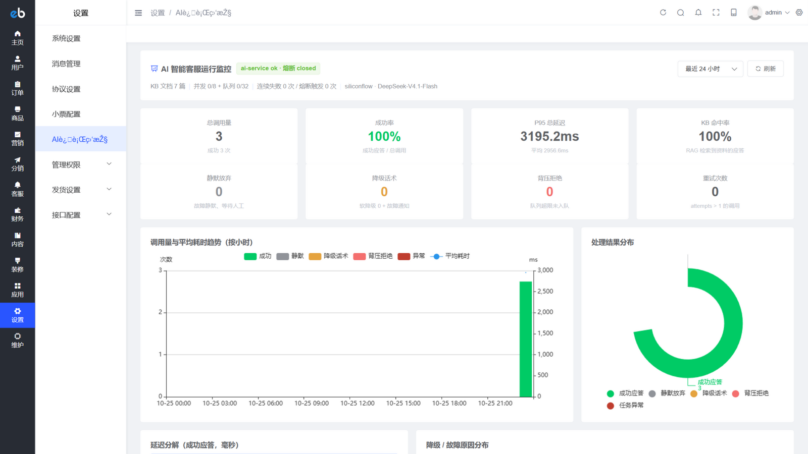
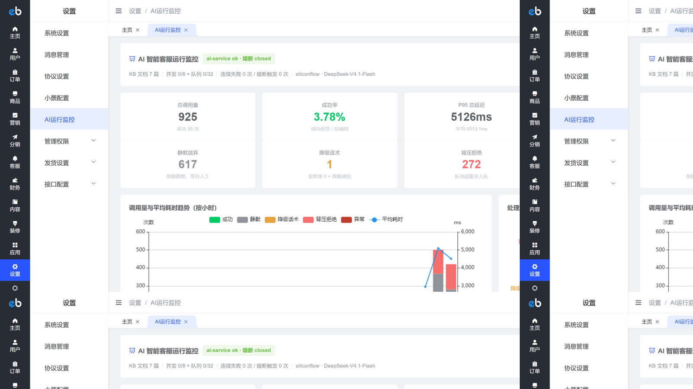
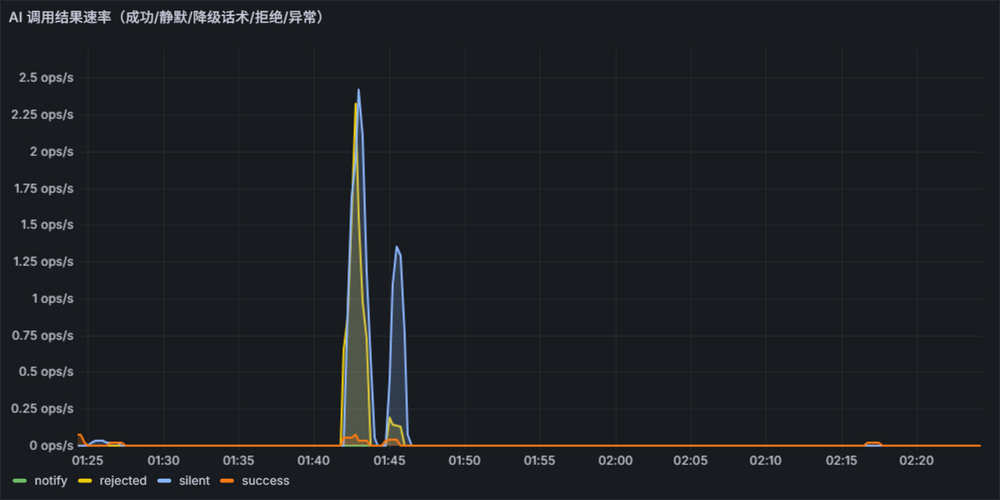
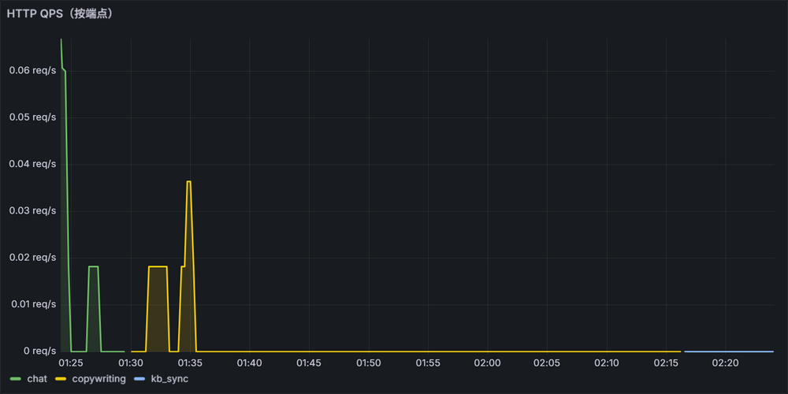

<div align="center">
    
</div>

# crmeb-ai-mall

> **基于 [CRMEB-KY v6.0.0](https://www.crmeb.com/?from=githubphp)（Apache-2.0）二次开发**的 AI 增强电商开源项目。
> 展品不是"给商城加了两个 AI 功能"，而是**把这条 AI 链路在工程上做实**：跨进程异步、超时分层、幂等、熔断降级、背压、trace 贯穿、指标量化、故障演练——每一项都有量化证据，而不是一句"支持高可用"。

<div align="center">

**AI 智能客服（RAG）** · **后台 AI 文案生成** · **双轨可观测（Prometheus/Grafana + 业务监控页）** · **一键部署（compose 全栈 7 服务）**

</div>

---

## 声明与致谢

- 本项目基于 **CRMEB-KY v6.0.0**（西安众邦网络科技，[Apache-2.0](LICENSE)）二次开发，**不宣称原创电商系统、不售卖**；
- 上游全部版权头、`LICENSE` / `LICENSE.txt`、品牌标识与官方链接均予保留；相对上游的修改以 **git 历史 + [docs/AI增强二开方案与进度.md](docs/AI增强二开方案与进度.md)** 逐窗口记录（Apache-2.0 §4b）；
- 上游资源：[官网](https://www.crmeb.com/?from=githubphp) · [帮助文档](https://doc.crmeb.com/single_open) · [技术社区](https://www.crmeb.com/ask/thread/list/147) · [应用市场](https://www.crmeb.com/market?from=githubphp) · [主题广场](https://www.crmeb.com/theme)

## 这个项目展示什么

在成熟电商系统（ThinkPHP 6 + Workerman + Vue2 + UniApp）上落地一条**经得起推敲的 AI 异步链路**：

| 能力 | 具体做法 |
|---|---|
| 跨进程异步 | 聊天 ws 进程微秒级派发 → think-queue → AI Worker 独立进程消费，主链路零阻塞 |
| 超时分层 | 连接 1s 快速失败 / 单次 HTTP 15s / 整体 SLA 20s 按发消息时刻计算剩余预算 |
| 重试与幂等 | 仅连接失败与 5xx 重试一次；`SETNX + user_msg_id` 双层幂等，一条消息只回一次 |
| 背压 | Worker 容量固定（8 并发 + 32 排队），队列超限毫秒级拒绝不堆积；同会话串行防乱序 |
| 熔断降级 | 连失 5 次开熔断 30s，open 期间 0–15ms 秒级拒绝；半开探测自动恢复，不盲目恢复 |
| trace 贯穿 | PHP 生成 `trace_id` → 队列参数 → `X-Trace-Id` 头 → 双端结构化 JSON 日志同 id 串联 |
| 指标量化 | 双轨可观测：进程内 `/metrics` + PHP 埋点表 exporter → Prometheus → Grafana 12 面板 |
| 故障演练 | 熔断状态机、上游 5xx、超时挂起、服务停机……全部真实注入并留下量化证据 |
| 静默降级 | AI 任何异常（含熔断/停机）都不影响原聊天功能，E2E 停机场景零污染验证 |

## 功能

### ① AI 智能客服（RAG，主线用例）

- **触发策略**：人工客服在线 → 人工优先绝不接管；离线 + 关键词回复未命中 → AI 接管（后台开关可控）
- **知识库**：在售商品（名称/价格/库存/卖点/详情）+ 客服话术 + 关键词回复，Chroma 向量库 + bge-m3 嵌入，MySQL 只读一键同步
- **有据回答**：检索命中不足/置信度低 → 引导转人工；资料没写的**不编造**（真实 API 实测：5G 制式未写则如实说不知道）
- **零前端改动**：回复以客服身份落库并 ws 推送，用户端聊天页完全复用原通路

### ② 后台 AI 文案生成（第二用例）

商品编辑页四个字段（标题/卖点/详情/SEO 关键词）「AI 生成」按钮：选语气 → 预填素材 → 生成 → 预览可编辑 → 应用。
与客服共用同一 ai-service、同一套熔断/背压/trace 观测链路——证明它是**通用 AI 能力平台**而非客服专用。

### ③ AI 运行监控（双轨可观测）

- **业务内**：`ai_call_log` 埋点表（每条消息至多一行、10 类终态）→ 后台「AI 运行监控」页（KPI 卡/趋势图/延迟分位分解/明细/trace 弹窗/健康徽标）
- **标准栈**：Prometheus + Grafana（数据源与 12 面板看板自动 provisioning，匿名只读），PHP 侧指标由增量游标 exporter 暴露

**后台「AI 运行监控」页**（左：常态——健康徽标透传 ai-service 探针，KPI 为真实 API 冒烟数据；右：全链路压测后——925 次调用、背压拒绝 272、静默放弃 617 全部量化可见）：

| 常态：健康徽标 + KPI + 趋势 | 压测后：背压拒绝/静默放弃量化 |
|:---:|:---:|
|  |  |

## 架构

```
用户(H5/小程序/APP) ──ws:40002──▶ CRMEB 聊天进程(Workerman)
                                     │ 关键词未命中 & 无人工在线 & AI开关开
                                     ▼ AiChatService 微秒级派发（幂等锁 + 背压检查 + trace_id）
                              think-queue(redis) ──▶ AI Worker(queue:listen)
                                     │ SLA 剩余预算 / history 构造
                                     ▼ HTTP(X-Trace-Id, 分层超时+受限重试)
                              FastAPI ai-service(:8000)
                                ├─ 幂等→同会话串行→背压→RAG(Chroma+bge-m3)→LLM(DeepSeek)→置信度→降级
                                ├─ 第二用例：/api/copywriting（后台文案，同一套可靠性原语）
                                └─ /api/health 探针 · /metrics 进程内指标
                                     │
                                     ▼ 落库(store_service_log + ai_call_log)
                              ChannelService 回推 → chat 进程 ws 推 reply（用户端零改动）

可观测：ai-service:/metrics + exporter(读 ai_call_log + 队列深度):/metrics
        ──▶ Prometheus(:9090) ──▶ Grafana(:30011, 12面板) ；后台监控页走 adminapi /ai/monitor/*
```

**可靠性七项标准的落地与实证**（详细矩阵见 [docs](docs/AI增强二开方案与进度.md) 第十二/十三节）：

| 标准 | 实现 | 实测证据 |
|---|---|---|
| trace_id 贯穿 | 生成→队列→HTTP 头→双端日志 | 同 id 双端日志，耗时分解互相印证（ai 1010ms ⊂ HTTP 1048ms ⊂ job 1104ms） |
| 超时分层 | 连接 1s / 单次 15s / SLA 20s | 注入挂起 16s → 15001ms 精确放弃，attempts=1 不重试 |
| 重试与幂等 | 仅 connect/5xx 重试一次；双层幂等 | 500 → attempts=2；超时 → attempts=1；重复投递只回一次 |
| 背压 | 入队前 LLEN 检查 + 服务内容量拒绝 | 队列峰值被钉在 51（阈值 50+1），超限 99.7% 毫秒级拒绝 |
| 熔断降级 | closed→open→half_open 状态机 | 连失 5 次 open；open 期 0–15ms 秒拒；半开探测失败 trips=2 不盲目恢复 |
| 健康检查 | /api/health 含 KB/熔断/背压探针 | 探针真实调用上游；admin 监控页 30s 轮询 |
| 优雅关闭 | AI 失败=放弃不重投 + 幂等锁防双发 | 停机场景零污染，原聊天功能全程可用 |

## 量化结果

### ai-service 直压（locust，fake provider 确定性注入）

| 场景 | 并发 | 结果 |
|---|---|---|
| 吞吐上限（0ms 注入延迟，RAG 全链路） | 20 | **92.7 RPS**，5511 请求 0 失败，P50=180ms / P95=300ms / P99=400ms |
| 容量内（注入 2.5s 延迟，容量 8+32=40） | 30 | **0 拒绝**，全部排队消化（排队延迟线性增长） |
| 容量外 | 60 | **99.7% 秒级拒绝**（313/314，`ai_queue_rejected_total` 精确计数），1ms 级返回而非 20s 超时 |

### 全链路背压压测（PHP→队列→ai-service→落库推送，300 条消息 @10/s 突发，消费能力 0.4/s）

| 观测 | 数值 |
|---|---|
| redis 队列深度 | 峰值 **51 = 阈值 50 + 在处理 1 条**，背压生效后被钉住不再上涨 |
| 派发背压拒绝 | 133 条（44.3%），全部毫秒级放弃，用户零感知 |
| 总账 | **300/300 全部有终态记录**（拒绝/deadline 耗尽/上游失败/成功），无一条失踪，原聊天通路零影响 |

**Grafana 看板实测**（双数据源自动 provisioning）：左——PHP 链路调用结果率，压测时段 `rejected`/`silent` 尖峰与上表总账互相印证；右——ai-service HTTP QPS 按端点分解：

| AI 调用结果率（PHP 链路） | HTTP QPS（按端点） |
|:---:|:---:|
|  |  |

### 真实 API 冒烟（SiliconFlow DeepSeek-V4.1-Flash + bge-m3）

RAG 命中 4 sources，回答**如实无幻觉**（库存 400 / 价格 2299 / 48h 发货均引自 KB；资料未写的 5G 制式不编造并建议转人工）；E2E 真实链路 total 4114ms，tokens 251+181，`kb_used:true`。

### E2E 场景矩阵（真实 ws + 真实容器，全部通过）

| 场景 | 断言 |
|---|---|
| 开关关闭 | 无 AI 回复、无落库、原通路正常 |
| 客服离线 | 收到客服身份 AI 回复 + 落库（实测 ~2s；真实 API ~4s） |
| 人工在线 | AI 不接管（无回复、无落库） |
| ai-service 停机 | 静默降级零污染，chat 进程存活可继续聊天 |
| 停机 + 通知开关 | 收到配置库降级话术 |

### 环境（Windows + Docker Desktop 9p 性能悬崖修复）

上游 compose 在 Windows/WSL2 下绑定挂载走 9p（单次元数据 ~216ms），框架接口实测 **>60s 504**；改命名卷 + tar 流式同步 + OPcache/realpath 调优后：H5 首页 **4–11ms**、adminapi **15–47ms**，全量同步 12592 文件 / 247MB 仅 **32.6s**。

## 一键部署（Docker Compose）

compose 编排 **7 个服务**：nginx(:8011) / php-fpm(+workerman :40001-40002) / mysql(:33061) / redis(:63791) / **ai-service(:8000)** / **prometheus(:9090)** / **grafana(:30011，admin/admin123 或匿名只读)**，另有指标 exporter(:9877)。

```bash
git clone https://github.com/yu788587-dot/crmeb-ai-mall.git
cd crmeb-ai-mall

# 1) AI 服务配置（不填 key 也能跑：默认 fake 离线模式，单测/演示可用）
cp ai-service/.env.example ai-service/.env
#    可选：填入 SILICONFLOW_API_KEY 并 LLM_PROVIDER=siliconflow 启用真实模型

# 2) 全栈启动（国内网络建议先配置 registry mirror，见 help/docker/docker.md）
cd help/docker && docker compose up -d

# 3) 同步 PHP 代码进容器（Windows/WSL2 下绕开 9p 的关键步骤，此后改 PHP 代码也走它）
bash sync.sh

# 4) 浏览器打开 http://localhost:8011 走安装向导（务必勾选「保留演示数据」，AI 知识库依赖演示商品）

# 5) 导入 AI 配置与监控（菜单/埋点表，幂等可重放；注意 utf8mb4）
docker exec -i crmeb_mysql mysql -uroot -p123456 --default-character-set=utf8mb4 crmeb < ../../help/sql/ai_service_config.sql
docker exec -i crmeb_mysql mysql -uroot -p123456 --default-character-set=utf8mb4 crmeb < ../../help/sql/ai_monitor.sql

# 6) 灌知识库（在售商品 + 客服话术 + 关键词回复 → Chroma 向量库）
curl -X POST http://localhost:8000/api/kb/sync
```

验证：`GET http://localhost:8000/api/health` 返回 `status: ok`；后台「设置 → AI 智能客服」开关可控；Grafana `http://localhost:30011` 看板自动就绪。

> E2E 与压测脚本随仓库提供：`help/dev/chat-e2e.mjs`（基线聊天）、`help/dev/ai-chat-e2e.mjs`（AI 五场景）、`help/dev/ai-load-e2e.mjs`（全链路压测）、`ai-service/drill_breaker.py`（熔断演练）、`ai-service/locustfile.py`（直压）。

## 本地演示账号（仅演示数据）

| 角色 | 账号 | 密码 |
|---|---|---|
| 后台 | admin | crmeb.com |
| 客户（uid=2） | 13800000002 | crmeb123456 |
| 客服（uid=1） | 13000000000 | kefu123456 |

## 二开改动总览

相对上游的修改按 6 个执行窗口组织，每窗口独立验收并提交（完整执行记录含踩坑与量化证据见 **[docs/AI增强二开方案与进度.md](docs/AI增强二开方案与进度.md)**）：

| 窗口 | 内容 | 代表性产出 |
|---|---|---|
| 1 环境与基线 | compose 全栈 + 9p 性能修复 + 聊天 E2E 基线 + admin 构建链预验 | `help/docker/sync.sh`、`help/dev/chat-e2e.mjs` |
| 2 AI 微服务 | FastAPI + RAG + 可靠性原语（熔断/重试/背压/幂等/串行） | `ai-service/`（pytest 28 passed） |
| 3 集成与可靠性 | ChatHandle 挂接 + AI Worker + 七项标准 + 后台低代码开关 | `AiChatService/AiChatJob/AiClient`、五场景 E2E |
| 4 可观测与量化 | 埋点表 + 后台监控页 + Prometheus/Grafana + locust 压测 + 故障演练 | `ai_call_log`、监控页、12 面板看板 |
| 5 后台 AI 文案 | adminapi 接口 + 商品编辑页 AI 生成 + 构建部署 | `Copywriting` 控制器、`aiCopywriting.vue` |
| 6 文档与开源 | README/文档/compose 一键部署 + 发布 | 本文档与 Release v1.0.0 |

对上游的小修复（README 或 PR 候选）：安装模板 `.env` CR 换行导致 `parse_ini_file` 解析失败（已改 LF 并以 `.gitattributes` 锁定）。

## 技术栈

- **上游电商**：ThinkPHP 6 / Workerman / Vue2 + ElementUI / UniApp / MySQL / Redis（详见上游文档）
- **AI 微服务**：Python 3.12 · FastAPI · openai 兼容 SDK（SiliconFlow DeepSeek + bge-m3）· ChromaDB · httpx 分层超时 · prometheus-client
- **可观测**：Prometheus + Grafana（provisioning 自动注入）· 结构化 JSON 日志 · `ai_call_log` 埋点表 + 增量游标 exporter
- **可靠性**：熔断状态机 / 受限重试 / 信号量背压 / 同会话串行 / 幂等去重 / SLA 预算（PHP 与 Python 双端各自实现并配合）

## License

- 本仓库遵循 **Apache-2.0**（随上游继承，见 [LICENSE](LICENSE) 与 `crmeb/LICENSE.txt`）；
- AI 微服务部分（`ai-service/`）与二开脚本（`help/`）为增量代码，同样以 Apache-2.0 发布。

---

<div align="center">

**CRMEB 官方**：[官网](https://www.crmeb.com/?from=githubphp) · [在线体验](http://v6.crmeb.net/admin/) · [帮助文档](https://doc.crmeb.com/single_open) · [应用市场](https://www.crmeb.com/market?from=githubphp) · [技术社区](https://www.crmeb.com/ask/thread/list/147) · [主题广场](https://www.crmeb.com/theme)

感谢 CRMEB 开源 —— 本项目在其基础上进行 AI 工程化实践并向社区开放。

</div>
